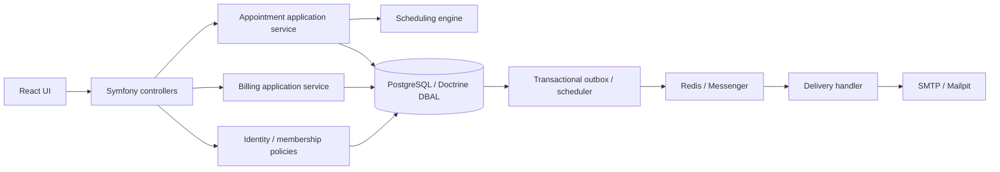

# Архітектура

Модульний Symfony-моноліт зі специфічними application services: `Identity`, `Scheduling`, `Appointment`, `Billing`, `Notification`. HTTP controllers виконують роль presentation/DTO validation. `Store` надає tenant-scoped single-resource lookup, пагінацію й append-only аудит. Окремий React/TypeScript застосунок збирається Vite в `public/app`.

## Persistence

Doctrine ORM mapping для identity `User`; Doctrine DBAL для транзакційних агрегатів і read models; Doctrine Migrations для повної схеми. Для booking і billing DBAL явно керує блокуваннями PostgreSQL, exclusion constraint і атомарним записом історії/outbox. Схема в `migrations/Version20261103000000.php` — джерело істини. `doctrine:schema:update` не використовується, бо ORM не описує всі таблиці.

ER-діаграма моделі наведена в §7.3 вихідного ТЗ і відповідає основним зв’язкам міграції. Access tokens, reset tokens та rate limits — додаткові технічні таблиці.

## Межі транзакцій

- Booking: optional advisory lock для ключа ідемпотентності → lock doctor → повторна перевірка графіка → insert appointment → event/audit/outbox → commit.
- Schedule: lock doctor → зміна → перевірка всіх майбутніх активних прийомів → audit → commit; конфлікт відкочує всі зміни.
- Status/reschedule: lock doctor → lock appointment → перевірка `version` і state machine → update/event/audit/outbox.
- Payment: lock appointment → перевірка signed total та валюти → insert ledger/audit.
- Refresh: lock refresh token → rotation; повторне використання відкликає сім’ю та її access tokens у committed transaction.

## Конфіденційність

Немає глобального patient repository lookup. Об’єкти завжди читаються за `(clinic_id,id)`; tenant зв’язки додатково захищені складеними FK. Лікарі читають лише пацієнтів власних прийомів і лише дозволені контактні поля. Platform role не обходить членство клініки. Відповіді API мають `Cache-Control: no-store`. CSV не містить контактних даних і захищає від formula injection.

Audit зберігає action/subject/actor/request ID та мінімальні дозволені поля. Токени й паролі не включені до audit. Вимкніть debug/profiler у production, обмежте доступ до логів і встановіть retention.

## Доменні межі після рефакторингу

Бронювання та оплати мають окремі шари `Domain`, `Application`, `Infrastructure`, `Presentation`. `Bookings` і `Billing` оркеструють typed commands через порти; SQL залишився в Doctrine-адаптерах. `Appointment` захищає переходи статусів, версію й незмінний snapshot, `PaymentLedger` — баланс, валюту та сторнування. `Money`, `Uuid`, `TimeInterval`, `Email`, `PhoneNumber` є immutable value objects; статуси й дії — backed enums.

`TransactionManager`, `Clock`, `AppointmentRepository`, `BillingRepository`, `BookingAvailability`, `AppointmentEvents`, `IdempotencyStore` — невеликі контракти для конкретних сценаріїв. Doctrine-реалізації зберігають попередні locking та PostgreSQL constraints. Доменні помилки зі стабільними кодами перекладаються в HTTP на межі API.

`BookingUseCaseTest` працює без БД та Symfony через in-memory ports і frozen clock. PostgreSQL functional/concurrency тести окремо підтверджують реальну ізоляцію й блокування. `BoundariesTest` забороняє залежності Domain від Symfony/Doctrine/HTTP та SQL у transactional use cases. `phpstan-domain.neon` перевіряє Domain/Application та Bookings/Billing на level 9; базова перевірка всього наявного проєкту — level 5.

Довідникові CRUD, Identity та reporting залишаються простішими сервісами/read models. Тут не створено порожніх абстракцій лише для повної симетрії директорій. Повний ORM mapping усіх таблиць не додавався: джерело схеми — Doctrine migrations.
